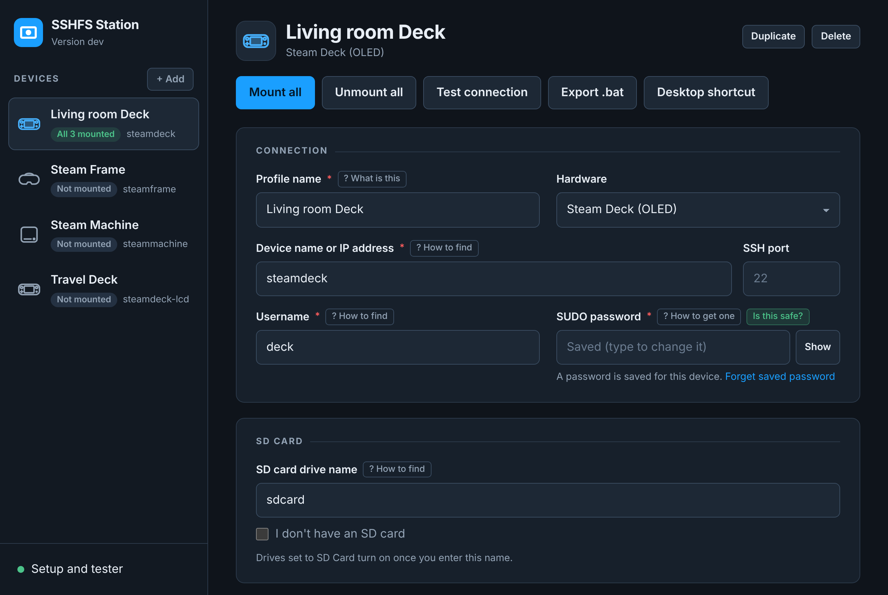

# SSHFS Station

Map the drives of your **Steam Deck (LCD)**, **Steam Deck (OLED)**, **Steam Machine** and **Steam Frame** into Windows as normal drive letters, over SSH.

SSHFS Station grew out of the [SSHFS batch file generator](https://www.mwcontent.com/steamdeck/sshfs.php) web page. Instead of making a `.bat` file you have to keep track of, it is a small Windows app that remembers every device you own and mounts them with one click, a desktop shortcut or a command.



## What it does

- **Unlimited devices.** Add as many Decks, Steam Machines and Steam Frames as you own, two of the same model included. Each one has its own name, address, port, username, password, SD card and drive letters.
- **Drive mappings per device.** Home, SD Card, Root or any custom path, on up to 8 letters. New devices start as Home, SD Card and Root on the next free letters (X Y Z, then W V U, and so on), so two devices can be mounted at the same time.
- **Mount, unmount and status** for the whole device or one drive at a time. It shows what is mounted and what clashes with another drive letter.
- **Setup and tester.** Checks for WinFsp and SSHFS-Win and installs whatever is missing from their official GitHub releases. Each download is checked against GitHub's SHA-256 before it runs, and Windows asks for permission. The self-test confirms everything is registered.
- **Version checks and updates.** Shows the installed version of WinFsp and SSHFS-Win next to the latest release, with release notes. When an update is out, the Setup dot turns amber and one button installs it. Nothing updates without you pressing it.
- **Test connection.** Step by step: does the name resolve, is the SSH port open, does an SSH server answer. Each failed step says what to try.
- **Command line.** `sshfs-station "Living room Deck"` mounts that profile without opening the window. See [Command line](#command-line).
- **Desktop shortcuts** that mount one device in a double-click, and an optional **mount at sign-in**.
- **Export .bat** still works if you want the original script.
- **Passwords are encrypted** with your Windows account (DPAPI). They are never written in plain text (except in an exported .bat, which warns you) and never sent anywhere but your device.

## Install

1. Download the latest `sshfs-station-...-windows-x64.zip` from [Releases](https://github.com/darkuni/sshfs-station/releases) and unzip it anywhere.
2. Run `sshfs-station.exe`. It opens in its own window (Microsoft Edge in app mode, which ships with Windows; nothing else is installed).
3. If WinFsp or SSHFS-Win is missing, the **Setup and tester** page installs both for you.

Windows 10 or 11, x64. Windows SmartScreen may warn the first time because the app is not code-signed. Choose **More info > Run anyway**.

## Prepare your device

On the Steam Deck, Steam Machine or Steam Frame, switch to Desktop Mode, open Konsole and run:

```sh
passwd                               # set a password if you never have
sudo systemctl enable --now sshd     # turn on SSH
hostname                             # the name to use (or: ip -4 addr for the IP)
```

The default username is `deck` on a Steam Deck and `steamos` on a Steam Frame. New profiles start with the right one.

Then add the device in SSHFS Station and press **Test connection**.

If you own more than one Deck, give each its own hostname (in Konsole: `sudo hostnamectl set-hostname deck-two`) or use their IP addresses. Otherwise they all answer to `steamdeck`.

## Command line

`sshfs-station.exe` is the windowed app. When you give it arguments it does the job without opening a window. From a shortcut, it shows a short message box with the result. **`sshfs-station-cli.exe`** is the same program built as a console app: it prints to the terminal, waits until it is done and sets the exit code, so use it in scripts.

```text
sshfs-station "<profile>"              mount every drive of a profile
sshfs-station mount "<profile>" [--letters X,Y] [--quiet]
sshfs-station mount --auto             mount every profile set to mount at sign-in
sshfs-station unmount "<profile>" [--letters X,Y]
sshfs-station unmount --all            unmount every profile
sshfs-station status ["<profile>"] [--json]
sshfs-station list [--json]
sshfs-station test "<profile>"         check the device can be reached over SSH
sshfs-station export "<profile>" [--out file.bat]
sshfs-station check                    check WinFsp and SSHFS-Win and their versions
sshfs-station setup                    download and install whatever is missing
sshfs-station update                   update WinFsp and SSHFS-Win to the latest releases
sshfs-station help | version
```

Names ignore case, and a unique start of the name is enough (`living` finds `Living room Deck`). Put names with spaces in double quotes. If a profile is named like a command (`list`), use `mount "list"`.

Exit codes: `0` success, `1` failure, `2` bad usage.

Options for any command:

| Option | What it does |
| --- | --- |
| `--demo` | Simulated drives and four sample devices. Nothing is mounted. Handy for trying the app or working on it. |
| `--data-dir <folder>` | Keep profiles in another folder. |
| `--no-window` | Start the app without opening a window and print its address (for development). |

## Where things are kept

| What | Where |
| --- | --- |
| Profiles | `%APPDATA%\sshfs-station\devices.json` |
| Passwords | `%APPDATA%\sshfs-station\secrets\` (DPAPI, only your Windows account on this PC can read them) |
| Window settings | `%APPDATA%\sshfs-station\window\` |
| Mount at sign-in | One shortcut, `SSHFS Station autostart`, in your Startup folder (`shell:startup`) |

**Portable copy:** put an empty file named `portable` next to `sshfs-station.exe` and everything is kept in a `data` folder beside it instead. Passwords still only open for the Windows account that saved them.

## How it works

- Drives are mapped with the Windows network API (`WNetAddConnection2`, the same call `net use` makes) to `\\sshfs.r\user@host[!port]\path`. SSHFS-Win serves those paths through WinFsp. The password goes straight to that API. It is never put on a command line.
- Drives mapped by the app are not "persistent" Windows mappings. That way Windows never shows a disconnected drive with a red X at sign-in. Use **Mount automatically when I sign in** instead.
- The window is a local web page served by the app itself on `127.0.0.1`. The server only answers to that address, checks the `Host` header, and needs a random token that changes every run. Other web pages cannot use it.
- Installed versions come from the Windows list of installed programs. The latest versions come from the GitHub releases of WinFsp and SSHFS-Win, looked up at most once an hour. Updating runs the newer official installer over the old one, WinFsp first.
- The app remembers which drives it mounted. If you edit a profile while it is mounted, the old drives show as **Mounted (old settings)**, and pressing Mount again replaces them.

## Troubleshooting

| Message | What to do |
| --- | --- |
| Windows was denied access (error 5) | SSH is usually not running on the device. In Desktop Mode open Konsole and run `sudo systemctl enable --now sshd`, then press **Test connection**. |
| Windows could not find the device or SSHFS-Win (error 53 or 67) | Check the device is on and the name or IP is right. Run **Setup and tester**. Restart Windows if you just installed WinFsp. |
| The device refused the username or password (error 86 or 1326) | Check the password and username (`deck` by default). |
| Windows already has a connection to this device with different credentials (error 1219) | Unmount that device's other drives, then mount again. |
| Drive letter is already in use (error 85) | Pick another letter. Letters used elsewhere are marked in the list. |
| Drives do not show up in Explorer | Do not run SSHFS Station as administrator. Drives mapped by an elevated program are invisible to a normal Explorer window. |

## Building from source

Go 1.24 or newer. There are no dependencies outside the Go standard library.

```sh
go test ./...
GOOS=windows GOARCH=amd64 go build -ldflags "-H windowsgui" -o sshfs-station.exe .
GOOS=windows GOARCH=amd64 go build -o sshfs-station-cli.exe .
```

On Linux or macOS, `go run . --demo` runs the app in demo mode in your browser, which is the easiest way to work on the interface.

Pushing a tag like `v1.0.0` makes GitHub Actions test, build and publish a release with the zip attached.

### Layout

| Path | What is there |
| --- | --- |
| `main.go` | Starts the window or runs a command |
| `internal/core` | Profiles, Steam hardware models, path building, validation, .bat export |
| `internal/app` | Mount, unmount, status, test and export, shared by the window and the command line |
| `internal/system` | Windows: network API, WinFsp/SSHFS-Win detection and install, DPAPI, shortcuts. Plus a simulated version for demo mode and tests |
| `internal/server` | The local API behind the window |
| `internal/cli` | The command line |
| `internal/launcher` | Opens the window and keeps to one running copy |
| `web` | The interface (plain HTML, CSS and JavaScript, built into the .exe) |

## Credits

- [WinFsp](https://github.com/winfsp/winfsp) and [SSHFS-Win](https://github.com/winfsp/sshfs-win) by Bill Zissimopoulos do the real work.
- Based on the [SSHFS batch file generator](https://www.mwcontent.com/steamdeck/sshfs.php) from MonroeWorld.

## License

MIT. See [LICENSE](LICENSE).
